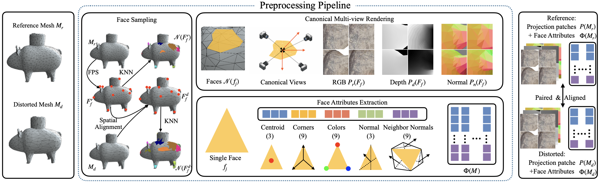
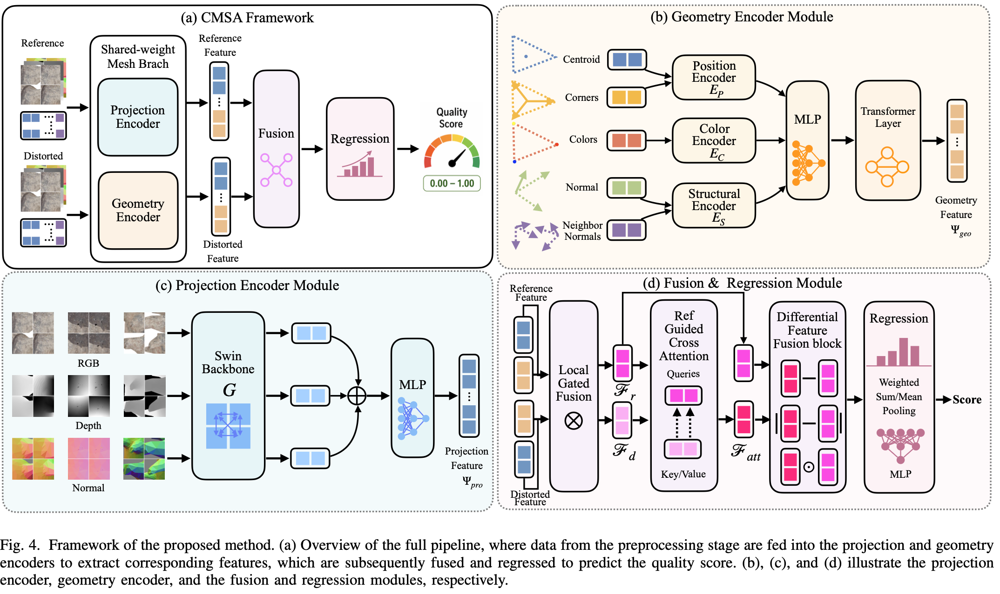
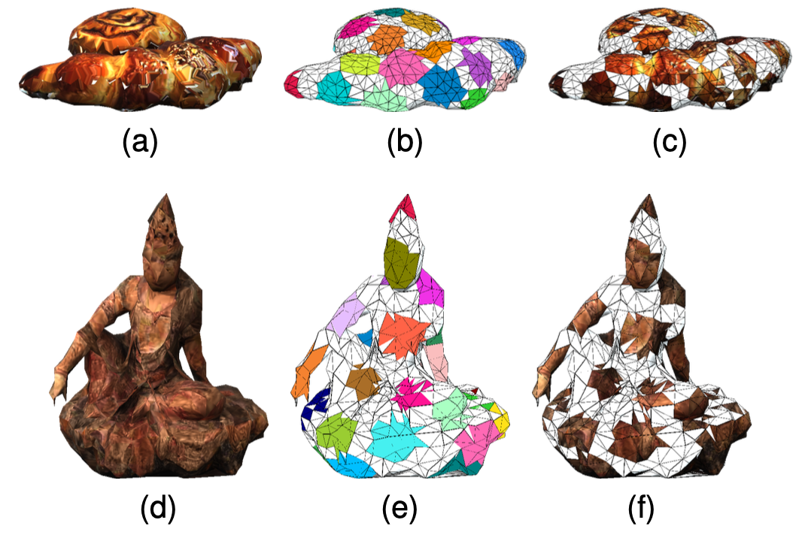

# CMSA

**Cross-Modal Spatial Alignment Method for Full-Reference Textured Mesh Quality Assessment**

This repository contains the implementation of **CMSA (Cross-Modal Spatial Alignment)**, a hybrid method for full-reference textured mesh quality assessment. Given a reference mesh and a distorted mesh, CMSA jointly models intrinsic 3D geometry and rendered appearance to predict a perceptual quality score.

## Overview

CMSA compares reference and distorted meshes through spatially aligned local regions:

1. **Spatial alignment:** sample anchor faces from the reference mesh and locate corresponding regions on the distorted mesh.
2. **Multi-modal representation:** extract face-level geometric attributes and aligned RGB, depth, and surface-normal projection patches.
3. **Feature encoding:** encode local geometry with a geometry encoder and projection patches with a pretrained Swin Transformer Tiny backbone.
4. **Fusion and comparison:** combine the two modalities through local gated fusion, reference-guided cross-attention, and differential feature fusion.
5. **Quality regression:** aggregate local features and regress a scalar quality score, using MSE and pairwise ranking losses during training.

### Preprocessing Pipeline



**Fig. 1.** Spatially aligned face sampling, canonical multi-view rendering, and face-attribute extraction for reference and distorted meshes.

### Model Framework



**Fig. 2.** The CMSA framework, including the geometry encoder, projection encoder, and fusion and regression modules.

### Visulization 

**Fig. 3.** Examples of the FPS and KNN sampling. (a) and (d) show the source model, (b) and (e) describe the sampled faces after
sampling, and (c) and (f) show the sampled faces with texture.

## Results

The following results are reported in the manuscript using content-disjoint five-fold cross-validation. Each metric is the median across the five folds.

| Dataset | PLCC ↑ | SRCC ↑ | RMSE ↓ |
| --- | ---: | ---: | ---: |
| TSMD | 0.930 | 0.929 | 0.617 |
| SJTU-TMQA | 0.902 | 0.903 | 1.570 |
| YANA | 0.890 | 0.895 | 0.676 |

## Repository Structure

```text
CMSA/
├── model.py                          # Geometry/projection encoders and quality models
├── dataset.py                        # Dataset loaders and content-based splits
├── process_aligned_fr_diverse_mv.py   # Aligned multi-modal mesh preprocessing
├── train-5fold-sw.py                  # Training, evaluation, and five-fold summaries
├── utils.py                          # Mesh loading, ranking loss, and metrics
├── LICENSE
└── README.md
```

## Installation

Clone the repository:

```bash
git clone https://github.com/IntMeGroup/CMSA.git
cd CMSA
```

In a Python environment, install PyTorch, torchvision, and PyTorch3D (we use 0.7.5) with compatible versions for your CUDA environment. Then install the remaining dependencies:

```bash
python -m pip install numpy pandas scipy scikit-learn timm einops tqdm swanlab iopath pillow openpyxl
```

## Data Preparation

Obtain the datasets separately, including OBJ meshes, their material/texture files, and subjective quality annotations. Keep the dataset's original directory structure so that the loaders can resolve reference and distorted mesh pairs.

The preprocessing script and training script use the following dataset identifiers:

| Dataset | Preprocessing `--dataset_name` | Training `--dataset` | Required annotations |
| --- | --- | --- | --- |
| SJTU-TMQA | `SJTU-TMQA` | `TMQA` | `distortion_dataset/SJTU-TMQA_MOS.csv` (`name`, `model`, `MOS`) |
| TSMD | `TSMD` | `TSMD` | `TSMD_MOS.xlsx` (`PVS`, `MOS`) |
| YANA | `YN2023` | `YN2023` | `MOS+CI_3000stimuli.csv` (`stimulus`, `MOS`) |

Expected mesh paths include:

```text
SJTU-TMQA/
├── reference_dataset/<model>/<model>.obj
└── distortion_dataset/
    ├── SJTU-TMQA_MOS.csv
    └── <distortion>/<model>/...

TSMD/
├── TSMD_MOS.xlsx
├── Reference/<source>/<source>_C0-L5_deq_tri.obj
└── Distortion/<source>/<PVS>.obj

YN2023/
├── MOS+CI_3000stimuli.csv
└── <source>/
    ├── source/<source>.obj
    └── distortions/JPEG_resize<res>_quality<JPEG>/<source>_<simp>_<qp>_<qt>.obj
```

For SJTU-TMQA, texture downsampling and JPEG samples use `<distortion>/<model>/<level>/<model>.obj`; other samples use `<distortion>/<model>/<sample_name>.obj`.

YANA experiments use the 3,000 subjectively annotated stimuli. The TSMD loader excludes `thomas_fr00170`, `mitch_fr00001`, and `nathalie_fr00036`, whose reference meshes are not publicly available.

### Preprocess Meshes

For SJTU-TMQA:

```bash
python process_aligned_fr_diverse_mv.py \
  --root_dir /path/to/SJTU-TMQA \
  --dataset_name SJTU-TMQA \
  --output_replace SJTU-TMQA-geotexdn \
  --device cuda:0 \
  --N 32 --K 32 --P 4 \
  --H 112 --W 112 --render_size 512
```

Replace `/path/to` with your actual data directory. The script writes compressed `.npz` files into a parallel directory by replacing `--dataset_name` in each input path with `--output_replace`. In this example, `/path/to/SJTU-TMQA` becomes `/path/to/SJTU-TMQA-geotexdn`.

Copy the annotation file into the same relative location in the preprocessed directory:

```bash
cp /path/to/SJTU-TMQA/distortion_dataset/SJTU-TMQA_MOS.csv \
   /path/to/SJTU-TMQA-geotexdn/distortion_dataset/SJTU-TMQA_MOS.csv
```

For TSMD, use `--dataset_name TSMD --output_replace TSMD-geotexdn` and copy `TSMD_MOS.xlsx` to the output root. For YANA, use an input root named `YN2023`, set `--dataset_name YN2023 --output_replace YN2023-geotexdn`, and copy `MOS+CI_3000stimuli.csv` to the output root.

The main arrays in each preprocessed file are:

| Key | Shape | Description |
| --- | --- | --- |
| `geo` | `(N, K + 1, 33)` | Anchor-face attributes followed by K neighboring faces |
| `tex` | `(N, P, H, W, 3)` | RGB patches |
| `depth` | `(N, P, H, W, 1)` | Depth patches |
| `normal` | `(N, P, H, W, 3)` | Surface-normal patches |
| `tex_valid` | `(N, P)` | View-validity flags |

Reference files also store anchor and camera information used to align distorted meshes. Existing files are skipped by default; use `--cover_exist` to regenerate them. Keep the default 32 anchors and four views when using the current dataset loaders.

## Training and Evaluation

Run full-reference training on the preprocessed SJTU-TMQA dataset:

```bash
python train-5fold-sw.py \
  --dataset TMQA \
  --root_dir /path/to/SJTU-TMQA-geotexdn \
  --modeltype FR \
  --save exp \
  --kfold_seed 1 \
  --batch_size 4 \
  --num_epochs 50 \
  --lr 5e-5 \
  --weight_decay 5e-4
```

For TSMD or YANA, change `--dataset` to `TSMD` or `YN2023` and point `--root_dir` to the corresponding preprocessed directory.

**Set `--kfold_seed` explicitly for five-fold cross-validation.** The script runs fold indices 0–4. Without `--kfold_seed`, it runs five random 80/20 source-content splits instead. All samples from a source mesh stay within the same split.

During training, the dataset selects an anchor count between 12 and 28 each epoch and uses matching anchor indices for the reference/distorted pair. Evaluation uses all anchors. The script logs experiments through SwanLab and saves results under `exp/<timestamp>_<dataset>_<modeltype>/`:

- `ckpt/<fold>_best.pth`: best checkpoint for each fold, selected by SRCC + PLCC.
- `predictions/`: prediction CSV files for the best training and validation epochs.
- `five_fold_metrics.csv`: metrics for all five folds.
- `log_<fold>.txt` and `log.txt`: per-fold logs and aggregate summaries, including median metrics.

To inspect all available options:

```bash
python process_aligned_fr_diverse_mv.py --help
python train-5fold-sw.py --help
```

## License

The code is released under the [MIT License](LICENSE).

## Citation

If you find CMSA is helpful, please cite:

```bibtex
```
